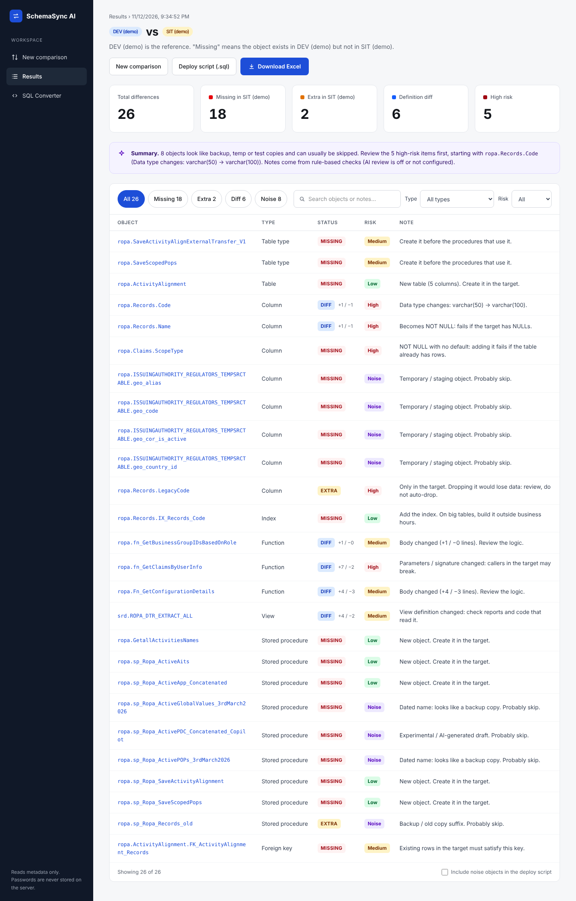

# SchemaSync AI

Compare two database environments (for example **DEV vs SIT**) and see exactly what is missing, extra or different, with AI notes on what matters. Export everything to Excel, generate a deployment script, and convert SQL between **SQL Server and Oracle**.



## Features

| | |
|---|---|
| **Schema compare** | Tables, columns, primary/unique keys, foreign keys, check constraints, indexes, views, stored procedures, functions, triggers, table types (+ columns), sequences, synonyms, Oracle packages |
| **Statuses** | `MISSING` (only in source), `EXTRA` (only in target), `DIFF` (definition differs) |
| **Smart normalisation** | Ignores whitespace, comments, case and `[brackets]`; auto-generated constraint names (`PK__Tbl__3214EC07…`) are matched by their columns, not their names |
| **Risk + noise (no AI needed)** | Flags backup / temp / test objects (`_3rdMarch2026`, `_Copilot`, `_old`, `TEMPSRCTABLE`…), signature changes, NOT NULL columns without defaults, data-type changes, data-loss risks |
| **AI review (optional)** | Claude, OpenAI, Azure OpenAI or Ollama reviews each difference: plain-English note, risk, noise flag |
| **Side-by-side diff** | Line-by-line view for every object |
| **Excel export** | Summary, All Differences, Missing, Extra, Definition Diff, Columns, Keys & Indexes, Code Objects, Deploy Script |
| **Deployment script** | Dependency-ordered SQL Server script: types → tables → columns → keys → indexes → code → foreign keys. Objects that exist only in the target are listed as commented-out DROPs, never dropped automatically |
| **SQL Converter** | T-SQL ⇄ Oracle PL/SQL. Rules convert functions, data types, TOP/FETCH, string joins, bind variables and more; AI finishes procedural code. Lists every change, warnings and a confidence level |
| **Demo mode** | "Try with demo data" works with no database, so you can see the app right after deploying |

## Tech stack

| Layer | Choice |
|---|---|
| App | Next.js 15 (App Router) + React 19 + TypeScript |
| UI | Tailwind CSS 4 (no component library, no CDN dependencies) |
| SQL Server driver | `mssql` (tedious), pure JavaScript |
| Oracle driver | `oracledb` in **Thin mode**, pure JavaScript (no Instant Client) |
| Diff | `diff` (jsdiff) |
| Excel | `exceljs`, generated in the browser |
| AI | Plain `fetch` to Anthropic / OpenAI / Azure OpenAI / Ollama |
| Hosting | Vercel (or Docker for self-hosting) |
| Tests | Vitest, about 280 unit tests, ~99% line coverage of server code |
| CI | GitHub Actions (typecheck → tests + coverage → build) |

## Documentation

| Guide | What's inside |
|---|---|
| [docs/GITHUB_GUIDE.md](docs/GITHUB_GUIDE.md) | Commit and push to github.com/miriyalas, branches, pull requests, Vercel link-up |
| [docs/HOSTING.md](docs/HOSTING.md) | Where to host: Vercel, Docker VM, Windows/IIS, Azure, AWS, Kubernetes |
| [docs/USER_GUIDE.md](docs/USER_GUIDE.md) | How to use every screen |
| [docs/TESTING.md](docs/TESTING.md) | How to run tests and the full scenario catalogue |
| [docs/ARCHITECTURE.md](docs/ARCHITECTURE.md) | Design, data model, compare algorithm |
| [docs/API.md](docs/API.md) | API endpoints with request and response examples |
| [docs/CONVERTER_RULES.md](docs/CONVERTER_RULES.md) | Every SQL Server ⇄ Oracle conversion rule |
| [docs/SECURITY.md](docs/SECURITY.md) | Data handling, read-only logins, protecting the app |

## How it works

```
Browser (Next.js pages)
  │  POST /api/compare  {source, target, options}
  ▼
API route ──► SQL Server / Oracle catalog views (read-only)  ──► snapshot A, snapshot B
          ──► compare engine (normalise → match → diff → rule-based risk/noise)
  │  JSON result
  ▼
Browser ──► POST /api/ai/review (batches of 20)  ──► AI notes merged in
        ──► Excel / deploy script built in the browser
```

Passwords are sent with each request and are **never stored** on the server. Saved profiles live in your browser's localStorage **without** passwords. Only schema metadata and SQL definitions go to the AI, never table data.

## Project structure

```
src/
  app/
    page.tsx                 New comparison (connections, options, demo)
    results/page.tsx         Results dashboard + filters + exports
    results/object/page.tsx  Side-by-side diff + review for one object
    converter/page.tsx       SQL Server ⇄ Oracle converter
    api/compare              Snapshot both databases and compare
    api/test-connection      Check a connection and permissions
    api/ai/review            AI review of differences
    api/ai/status            Is AI configured?
    api/convert              SQL conversion
  components/                UI pieces (diff viewer, editors, connection form)
  lib/
    db/sqlserver.ts          SQL Server metadata queries (sys.* views)
    db/oracle.ts             Oracle metadata queries (DBA_/ALL_ views)
    compare.ts               Compare engine
    analyze.ts               Rule-based risk + noise detection
    sqlScanner.ts            SQL lexer + normaliser
    converter/               T-SQL ⇄ PL/SQL rules + AI step
    ai.ts / aiReview.ts      AI providers and prompts
    deployScript.ts          Deployment script generator
    excel.ts                 Excel export
    demo.ts                  Built-in demo databases
  middleware.ts              Optional password protection
tests/                       Vitest unit tests (drivers and AI mocked)
docs/                        Guides (see Documentation above)
```

## Run locally

Requires Node.js 20+.

```bash
npm install
cp .env.example .env.local      # optional: add an AI key / app password
npm run dev                     # http://localhost:3000
```

Click **Try with demo data** to see it work without a database.

## Run the tests

```bash
npm test                # all unit tests
npm run test:coverage   # with coverage report (coverage/index.html)
```

See [docs/TESTING.md](docs/TESTING.md) for the scenario list.

## Deploy to Vercel

1. Push this folder to GitHub (full steps in [docs/GITHUB_GUIDE.md](docs/GITHUB_GUIDE.md)):
   ```bash
   git init && git add . && git commit -m "feat: SchemaSync AI"
   git branch -M main
   git remote add origin https://github.com/miriyalas/schemasync-ai.git
   git push -u origin main
   ```
2. In Vercel: **Add New → Project → Import** the repository. Framework preset: **Next.js**. No build settings to change.
3. Under **Settings → Environment Variables**, add:
   - `APP_PASSWORD` (strongly recommended: the app is otherwise public)
   - `AI_PROVIDER` + the matching key, for example `AI_PROVIDER=anthropic` and `ANTHROPIC_API_KEY=…`
4. Deploy. Open the URL and click **Try with demo data**.

### Important: Vercel must be able to reach your databases

All hosting options are compared in [docs/HOSTING.md](docs/HOSTING.md).

Vercel runs on the public internet. A comparison only works if the database servers accept connections from Vercel:

- The DB host must be reachable from the internet (public endpoint, Azure SQL / AWS RDS / OCI with firewall rules, or a VPN/tunnel your security team approves).
- Vercel's outbound IP addresses change unless you buy a static-IP option. Check Vercel's docs for what your plan offers before you rely on IP allow-listing.
- Servers that are only on the company network (typical for DEV/SIT) **cannot** be reached from Vercel. For those, run the same code inside the network with Docker (below). Demo mode, the converter and Excel export still work on Vercel.
- API routes ask for up to 60 seconds (`maxDuration`). Very large schemas may need more time than your Vercel plan allows; use Docker for those.

## Self-host with Docker (inside your network)

```bash
cp .env.example .env     # set APP_PASSWORD and AI settings
docker compose up -d --build
# http://<server>:3000
```

## Database permissions (read-only)

**SQL Server**, run in each database:

```sql
CREATE LOGIN schemasync_ro WITH PASSWORD = '<strong password>';
CREATE USER schemasync_ro FOR LOGIN schemasync_ro;
GRANT VIEW DEFINITION TO schemasync_ro;
```

**Oracle**:

```sql
CREATE USER schemasync_ro IDENTIFIED BY "<strong password>";
GRANT CREATE SESSION TO schemasync_ro;
GRANT SELECT ANY DICTIONARY TO schemasync_ro;  -- lets it read DBA_* views for any schema
```

Then enter the schema (owner) to compare in the Oracle connection form. Oracle schema names are ignored when matching objects, so `APP_DEV` vs `APP_SIT` compares correctly.

## AI configuration

| Variable | Example |
|---|---|
| `AI_PROVIDER` | `anthropic`, `openai`, `azure`, `ollama` or `none` |
| `ANTHROPIC_API_KEY` / `ANTHROPIC_MODEL` | Claude API key, model name (default `claude-sonnet-5-5`) |
| `OPENAI_API_KEY` / `OPENAI_MODEL` | OpenAI key, default `gpt-4o-mini` |
| `AZURE_OPENAI_ENDPOINT`, `AZURE_OPENAI_API_KEY`, `AZURE_OPENAI_DEPLOYMENT`, `AZURE_OPENAI_API_VERSION` | Azure OpenAI |
| `OLLAMA_BASE_URL`, `OLLAMA_MODEL` | Local model (self-hosted only) |

Without AI, everything still works: risk, noise and notes come from the rule-based checks, and the converter handles non-procedural SQL fully.

### AI concepts used

- **Hybrid rules + LLM**: exact work (what is missing or different, rule-based conversion) is done in code; the LLM only explains, classifies and finishes procedural conversions.
- **Structured JSON output**: the model returns `{risk, isNoise, note}` per item and `{sql, changes, warnings, confidence}` for conversions, so results go straight into the UI and Excel.
- **Classification**: noise detection and risk scoring.
- **Prompt engineering with a system role and hints**: the rule-based risk and draft conversion are passed in as hints.
- **Context minimisation**: only changed diff hunks are sent, not whole objects, and never table data.
- **Graceful fallback**: if the AI call fails, the rule-based result is shown with a warning.

## Limitations

- The deployment script uses SQL Server syntax (`CREATE OR ALTER` needs SQL Server 2016 SP1+). Review it before running.
- Comparing an Oracle database against a SQL Server database works, but types and code will differ by design; use the converter for code.
- The converter's rule engine covers common patterns. Always test converted code on a development database.
- SQL Server logins only (no Windows authentication from Vercel).
